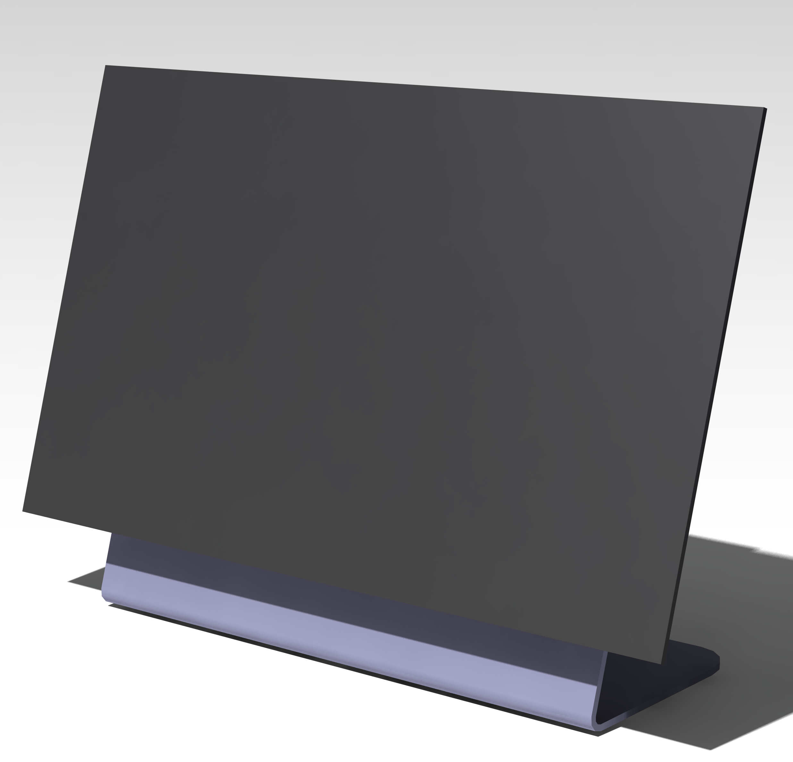
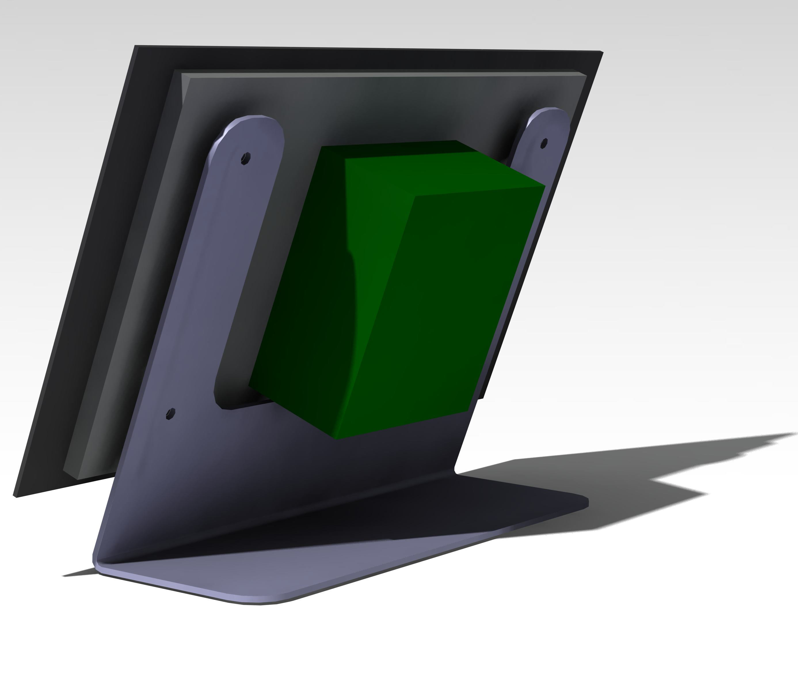
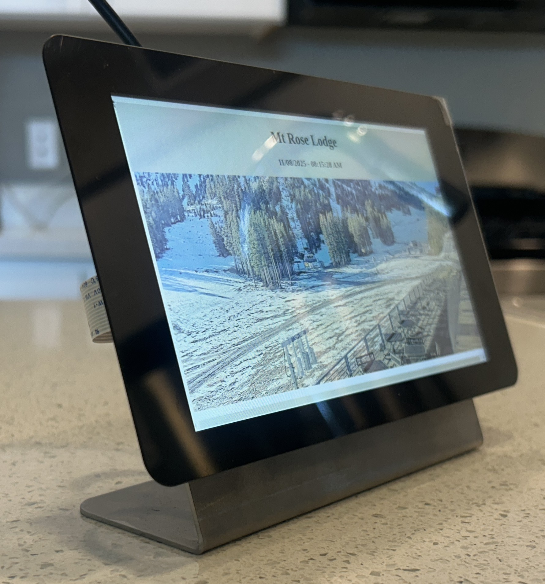
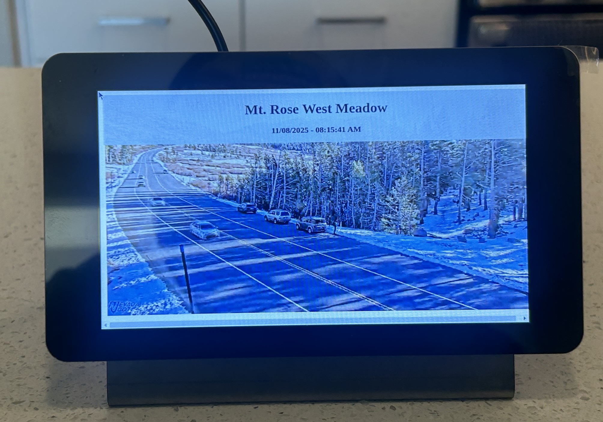
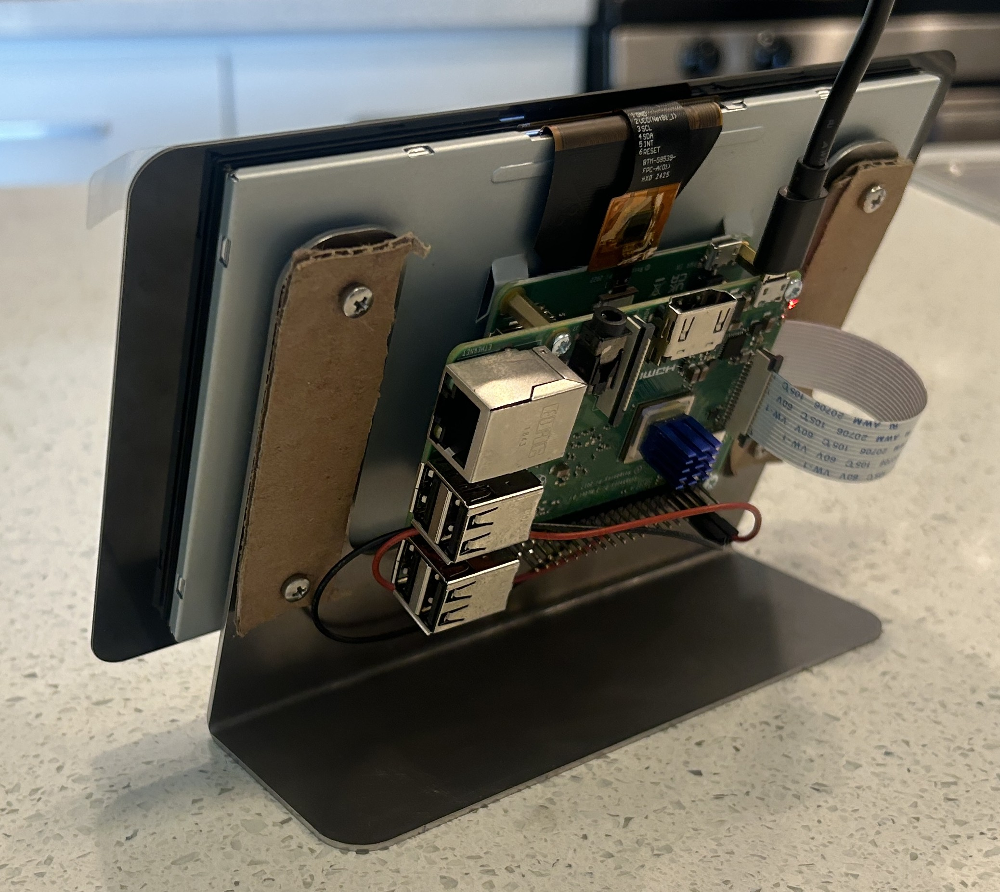

# What is this?
This is a webcam cycler that flips through webcams of places that I like. 

The conceptual idea comes from a live photo frame that I was recently gifted by my family. The live photo frame flips through photos added by family members, like a slideshow.

This project flips through various live web cameras in places that I like.

## Running and checking the cameras

### Start locally on Windows

Double-click `run_local.bat` (or run it from Command Prompt). It starts the
viewer at `http://127.0.0.1:5050/`; open that address in Chrome or your preferred
browser. The script uses the project's `.venv` Python if present, or the
`python` command on your PATH. If you need to install dependencies first, open
a terminal in the project folder and run:

```
python -m pip install -r requirements.txt
```

The server runs in a separate minimized console window; close that window to
stop it. If the server is already responding on port `5050`, the command reuses
it. You can also run `python main.py` directly; on Windows that opens the
viewer in your default browser.

The local launcher enables development reload: saving Python files or the
camera CSV restarts the Flask development server automatically, and saving the
viewer template, JavaScript, or CSS refreshes the browser page. Keep the viewer
open while editing; changes normally appear within a second or two. The first
time you switch from an already-running non-development server, close its
server window once and run `run_local.bat` again. Raspberry Pi startup remains
in production mode with development reload disabled.

This local setup runs the same Flask app, camera list, and viewer as the Pi, but
does not launch the Pi startup scripts, kiosk mode, scheduled services, or
hardware-specific mouse automation. Camera video is loaded directly from its
third-party provider, so your PC needs internet access and some feeds may not
be embeddable or available.

### Check the camera list and server

- `http://127.0.0.1:5050/health/` reports whether the app is running and how
  many camera entries it loaded.
- `http://127.0.0.1:5050/cameras/` lists every configured camera name and
  playback type. It is useful for confirming that the entries in
  `WebcamURLs_All.csv` were loaded.
- `http://127.0.0.1:5050/` opens the viewer.

The Flask server listens only on `127.0.0.1`; it is intended for a browser
running on the same device and is not exposed to other devices on the network.
The viewer embeds remote webcam pages but does not use the Pi's camera or
microphone; those permissions are denied to embedded pages.

At server startup, the camera list is shuffled once into a random order. The
viewer then advances through every camera in that order before repeating it.
Use the left and right edge click areas (or Left/Right arrow keys) to move
backward or forward within that same order; navigation wraps at both ends.
Restarting the server creates a new random order.
The selected camera position is also kept on the server as the viewer advances,
so a Chromium restart resumes after the last selected camera instead of
repeating the camera that caused the browser to fail.
The order is written to a temporary JSON file (`/var/tmp` on Linux) and read
when needed instead of being kept as a Python list. This only saves a few
hundred bytes; moving the camera definitions to disk would not meaningfully
reduce Chromium's video memory use.

The viewer uses a single player and does not preload the next camera. When a
timed switch starts, each candidate replaces the current stream and gets up to
12 seconds to become ready; if it doesn't, the viewer tries the next camera in
the randomized order. This avoids keeping an additional webcam player and its
buffers in memory, at the cost of a visible loading gap during switches.
Manual side-clicks immediately select the chosen stream. If every feed is
unavailable, the viewer retries shortly.

Direct HLS playback limits its buffer to about two seconds and 12 MiB to reduce
memory use; on a slow or inconsistent connection, this may cause more
rebuffering. Embedded webcam pages control their own memory and buffering.

The camera list is validated at startup. Missing columns, blank values,
unsupported playback types, invalid URLs, and unknown time zones are reported
instead of producing hard-to-diagnose playback errors later. If an HLS feed
fails or stalls, the viewer attempts recovery and then moves on to another
camera. Network and playback errors appear in the overlay and are logged in the
browser console.

Camera feeds are hosted by third parties, so a valid entry in `/cameras/` does
not guarantee that its provider is currently online or permits embedding.
Check the browser console and the provider's page if one specific feed remains
unavailable.

## How is auto-boot setup?
The startup script uses the project path shown above; update `APP_DIR` in
`rpiStart.sh` if the project is installed elsewhere.

For Raspberry Pi startup troubleshooting, `logs/logfile.txt` records launcher
steps and Chromium's exit status. Chromium diagnostics, including its version
and available memory and `/dev/shm` space at launch, are written to
`logs/chromium.log`. The kiosk starts Chromium through XWayland with GPU
compositing, rasterization, and hardware video acceleration disabled. The
viewer sends a heartbeat every 15 seconds. If Chromium's page renderer crashes
or stops responding, the watchdog restarts Chromium after about 90 seconds
without a heartbeat. This is useful on the Pi 3's memory- and
graphics-constrained desktop and does not change the camera list or playback
order.

If Chromium continues to crash, update the Pi's OS-managed browser package and
restart the kiosk service:

```
sudo apt update
sudo apt install --only-upgrade chromium
systemctl --user restart webcamcycler.service
```

The Chromium package and desktop session are Pi setup, not app dependencies,
so those package updates are not stored in Git. The app code and watchdog are
tracked here and deployed from `main`.

Commits pushed to the `main` branch are automatically deployed to the
Raspberry Pi.


# Hardware
Computer: Raspberry Pi 3B+ Trixie
Display: Raspberry Pi 7" touchscreen
Display mount: Custom bent 16Ga cold-rolled 1008 carbon steel sheet

## Pictures of final build
  

  

The mounting method uses 4x M3x0.5x8mm phillips button head bolts, as shown, they are too long for this applicaton, but that is what I had on hand. Instead of buying new bolts, or washers, I decided to make a 'washer' from some cardboard. It doesnt look great, but performs the needed function and is on the 'B' side; no harm, no foul.




## Tests

Run the camera-list and route tests on your PC with:

```
python -m unittest discover -s tests
```